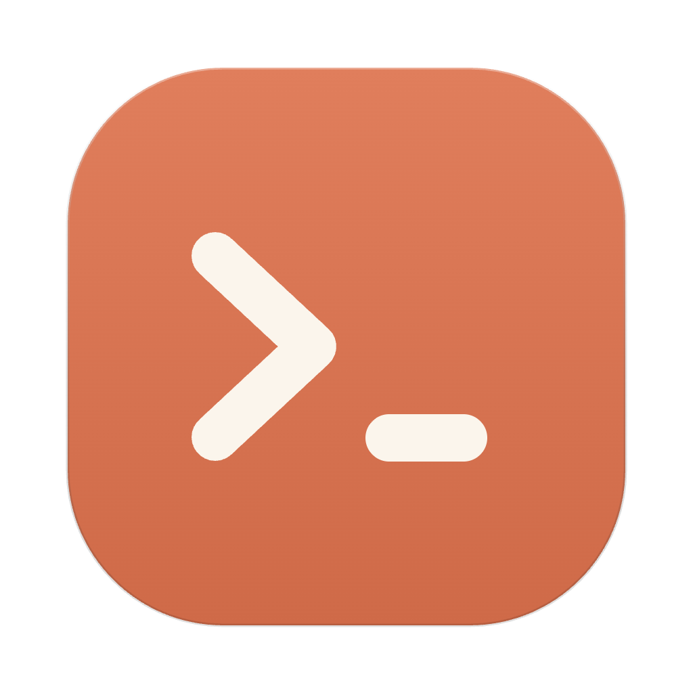
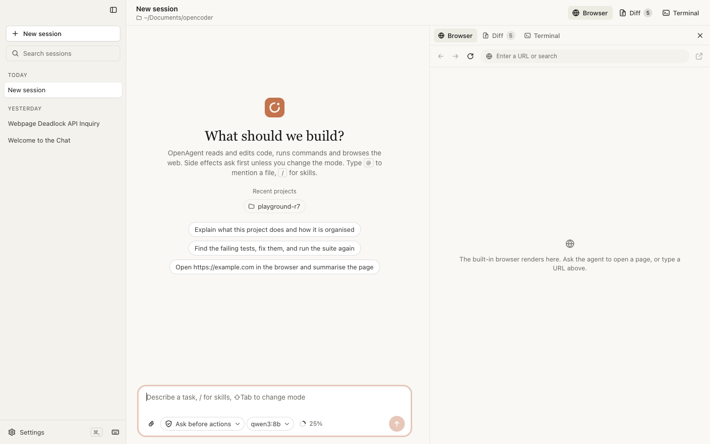
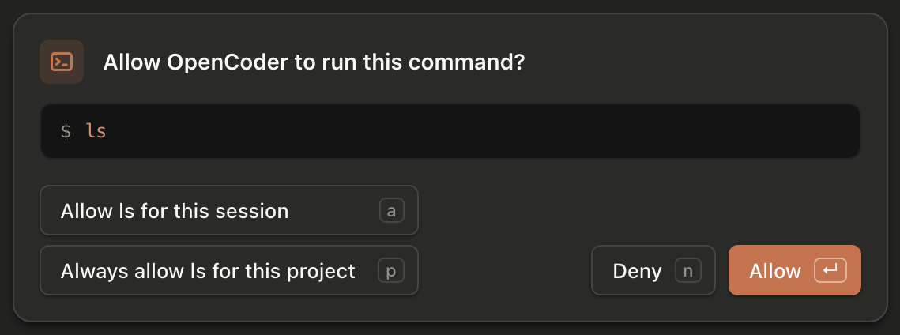
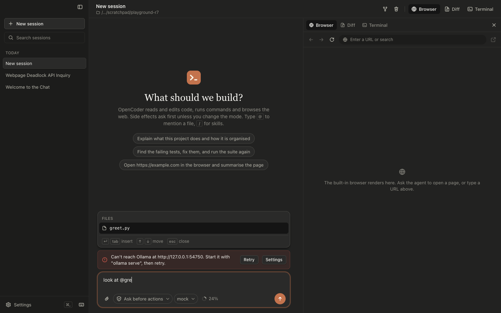
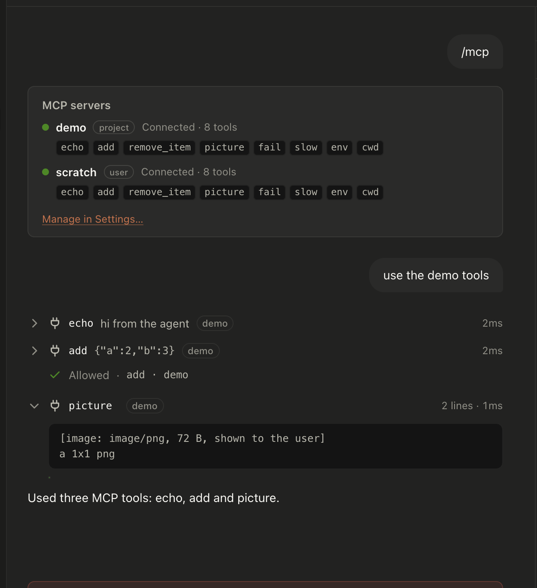
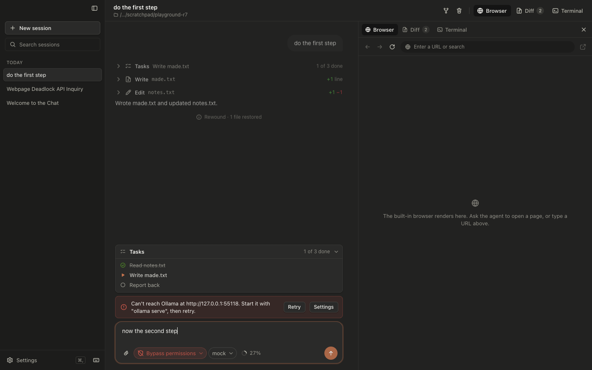
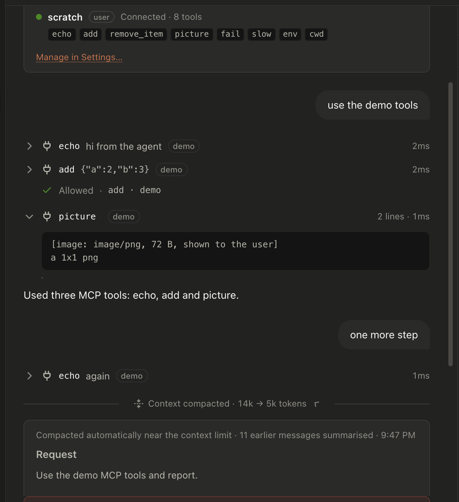

<p align="center"></p>
<h1 align="center">OpenAgent</h1>
<p align="center">Open-source Claude Code–style coding agent for macOS. Local models via Ollama, any provider via Portkey.</p>
<p align="center">
  <a href="LICENSE"></a>
  
  
</p>
<p align="center"></p>

## Why

- **Local first.** Runs on `qwen3:8b` through Ollama; nothing leaves your Mac. Built for small context windows: auto-compaction, a context meter.
- **The Claude Code workflow.** Permission modes, approval cards, plan mode, rewind, task list, queued messages, `@` file mentions, `#` memory.
- **See everything.** Tool rows with diffs, a Diff pane with revert, a real Terminal pane, a built-in browser the agent drives, artifacts beside the chat.
- **Standard extensions.** MCP servers (`.mcp.json`), skills (`SKILL.md`), project instructions (`OPENAGENT.md` / `AGENTS.md` / `CLAUDE.md`).
- **Small codebase.** Electron + TypeScript, no bundler, no framework.

## Quick start

```bash
brew install ollama && ollama serve &
ollama pull qwen3:8b
git clone https://github.com/BrandeisPatrick/openagent.git && cd openagent
npm install && npm start
```

Or download `OpenAgent.app` from [Releases](https://github.com/BrandeisPatrick/openagent/releases) (not notarized: right-click → Open the first time). Portkey: Settings → Provider → Portkey, add your key and a model id.

## Features

| | |
| --- | --- |
|  | **Approvals.** Enter allows, `a` for the session, `p` for the project. Auto mode pauses only on risky actions. |
|  | **Composer.** `@` file picker, `/` skills, image paste, messages queued mid-run. |
|  | **MCP.** Paste a command, URL or README snippet; tools appear as `mcp__server__tool`. |
|  | **Rewind and tasks.** Restore files and reopen a prompt; the agent keeps a task list. |
|  | **Compaction.** Near the context limit the agent writes a brief and continues. |

Also: sessions with search and fork, plan mode, artifacts, skills, vision models, macOS notifications. Details, keys and tools: [docs/reference.md](docs/reference.md). Roadmap: [docs/ux-backlog.md](docs/ux-backlog.md).

## Develop

```bash
npm run typecheck   # both tsconfigs
npm test            # headless suites (mock model, no Ollama needed)
npm run package     # OpenAgent.app in release/mac-arm64
```

`src/main` is the agent and tools, `src/renderer` the UI, `src/shared` the IPC contract. MIT.
